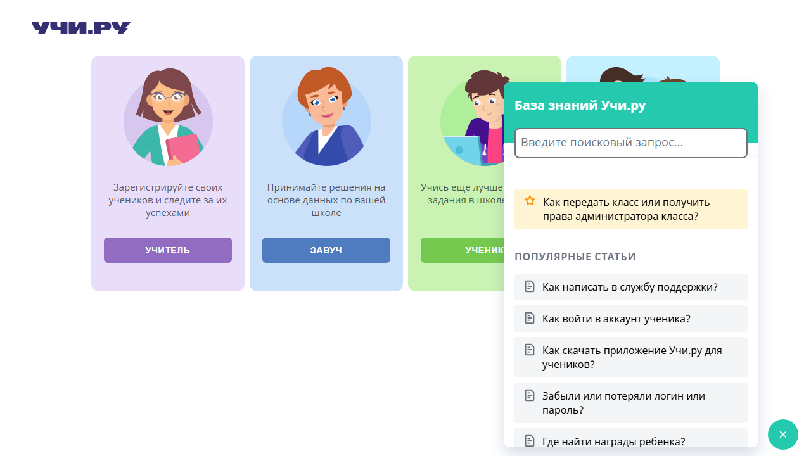
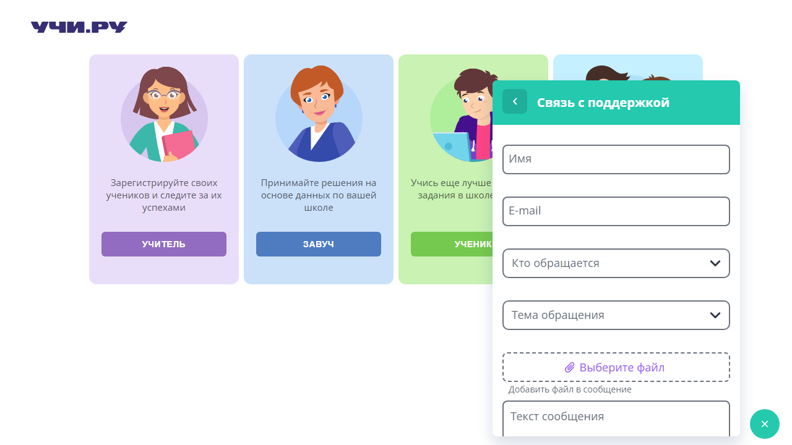

<div align="center">

# AQA Intern Challenge

**Автотесты виджета поддержки Учи.ру**

[](https://playwright.dev/)
[](https://www.typescriptlang.org/)
[](https://nodejs.org/)
[](https://www.docker.com/get-started/)
[](tests/widget.spec.ts)
[](LICENSE)
[](https://github.com/huksleva/aqa-intern-challenge/actions/workflows/playwright.yml)

[Демонстрация](#демонстрация) · [Быстрый старт](#быстрый-старт) · [Docker](#запуск-в-docker) · [Сценарии](#сценарии) · [Результаты](#результаты-проверки) · [Участие](CONTRIBUTING.md) · [Security](SECURITY.md)

</div>

Решение [тестового задания для AQA-стажёра](https://github.com/uchiru/aqa-intern-challenge). Исправлены два исходных автотеста и добавлен **один дополнительный тест** — закрытие и повторное открытие виджета. Ссылка на исходный проект и его лицензия сохранены.

## Демонстрация

Скриншоты сделаны автотестами на реальном сайте после проверки заголовков и загрузки формы. При запуске они также прикладываются к HTML-отчёту.

### Открытие виджета

После нажатия «Помощь» отображается база знаний с заголовком «База знаний Учи.ру».



### Переход к поддержке

Тест открывает статью «Как написать в службу поддержки?» и нажимает «Написать нам». В результате отображается форма «Связь с поддержкой»; сообщение не отправляется.



## Быстрый старт

Выберите один из трёх способов. В каждом варианте один блок команд: скопируйте его целиком и вставьте в указанную консоль. Запускайте из папки, в которой ещё нет каталога `aqa-intern-challenge`: первая команда скачает проект и создаст его.

Для всех способов нужен доступ к `https://uchi.ru` и CDN виджета. Учётная запись Учи.ру не требуется.

### Windows 10/11

Нужны установленные **Git** и **Node.js 22** с npm. Откройте **Командную строку (cmd)** и вставьте блок:

```bat
git clone https://github.com/huksleva/aqa-intern-challenge.git
cd aqa-intern-challenge
npm ci
npm run typecheck
npx playwright install chromium
npm test
```

После завершения тестов HTML-отчёт автоматически откроется в браузере. Сервер отчёта работает до нажатия `Ctrl+C`.

### Linux и macOS

Нужны установленные **Git** и **Node.js 22** с npm. Откройте **терминал (bash или zsh)** и вставьте блок:

```sh
git clone https://github.com/huksleva/aqa-intern-challenge.git
cd aqa-intern-challenge
npm ci
npm run typecheck
npx playwright install --with-deps chromium
npm test
```

На Linux команда установки Chromium также устанавливает системные зависимости и может запросить пароль `sudo`. После завершения тестов HTML-отчёт автоматически откроется в браузере. Для остановки сервера отчёта нажмите `Ctrl+C`.

### Запуск в Docker

Нужны **Git** и запущенный **Docker Desktop в режиме Linux containers** либо **Docker Engine с Compose**. Блок подходит для cmd, PowerShell и терминала Linux/macOS:

```shell
git clone https://github.com/huksleva/aqa-intern-challenge.git
cd aqa-intern-challenge
docker compose run --build --rm tests
docker compose up report
```

Первая команда Docker собирает образ, проверяет типы и запускает три теста. Следующая поднимает сервер полученного отчёта: откройте [http://localhost:9323](http://localhost:9323) в браузере. Для остановки нажмите `Ctrl+C`.

Node.js, Chromium и системные зависимости находятся внутри официального образа `mcr.microsoft.com/playwright:v1.64.0-noble`; версия совпадает с `@playwright/test`. Отчёт и диагностика сохраняются на компьютере в `playwright-report/` и `test-results/`. Сервер отчёта доступен только на локальном компьютере.

## Дополнительные команды

Выполняйте команды из папки проекта. По умолчанию тесты работают в Chromium без открытия окна браузера. При запуске через npm HTML-отчёт открывается автоматически, в том числе при результате `flaky`. В CI и Docker автоматическое открытие отключено. Если порт 9323 занят сервером предыдущего отчёта, остановите его через `Ctrl+C` перед новым запуском.

| Команда | Для чего |
| --- | --- |
| `npm test` | Повторно запустить все три теста и открыть отчёт |
| `npm run typecheck` | Проверить типы конфигурации и тестов без запуска браузера |
| `npm test -- --headed` | Запустить с видимым окном браузера |
| `npm test -- --ui` | Открыть интерактивный режим Playwright |
| `npx playwright test --list` | Посмотреть список сценариев |
| `npm run test:report` | Открыть HTML-отчёт последнего запуска |
| `docker compose run --build --rm tests` | Повторно запустить тесты в Docker |
| `docker compose up report` | Открыть сервер отчёта Docker на порту 9323 |
| `docker compose run --rm tests npm run typecheck` | Проверить типы в собранном контейнере |
| `docker compose down` | Удалить остановленный контейнер сервера отчёта и сеть Compose |

## Сценарии

| Тест | Проверка | Ожидаемый результат |
| --- | --- | --- |
| `opens` | Нажать кнопку открытия виджета | Виджет виден, заголовок — «База знаний Учи.ру» |
| `has correct title` | Открыть статью «Как написать в службу поддержки?» и нажать «Написать нам» | Заголовок меняется на «Связь с поддержкой» |
| `closes and reopens` | Открыть, закрыть и снова открыть виджет | После закрытия виджет скрыт и кнопка открытия видна; после повторного открытия отображается база знаний |

Третий сценарий — дополнительный тест по условию задания. Обращение в службу поддержки не отправляется.

### Страница и ожидания

Тесты открывают [`/signin/main`](https://uchi.ru/signin/main) — публичную страницу выбора входа с виджетом «Помощь». На главной странице есть ссылка «Войти другим способом», которая ведёт на этот маршрут. Сам `/` может показывать другую версию главной без виджета.

Первое открытие ожидает кнопку до **60 секунд**: скрипт виджета загружается отдельно с CDN. Общий лимит теста — 90 секунд, навигации — 45 секунд, проверки результата — 10 секунд. Если cookie-баннер появляется и перекрывает действие, обработчик Playwright нажимает видимую кнопку «принять» и ожидает скрытия баннера. Он работает и при позднем появлении уведомления. Фиксированных пауз нет. Для упавшего теста настроен один повтор в новом контексте браузера. Если проходит только повтор, Playwright отмечает тест как `flaky`; если обе попытки неуспешны — как `failed`.

## Что исправлено

| Проблема | Изменение |
| --- | --- |
| Cookie-баннер перекрывал кнопку «Помощь» | Добавлен обработчик видимого баннера через `page.addLocatorHandler()`, без принудительного клика сквозь перекрытие |
| Кнопка открытия зависела от устаревшего родительского CSS-класса | Использован `data-test="openWidget"` |
| `all()` мог вернуть пустой список до загрузки статей; статья выбиралась по позиции | Статья выбирается локатором по точному названию с ожиданием появления |
| Кнопка и заголовок проверялись ненадёжно | Кнопка находится по роли и имени; заголовок проверяется через `toHaveText()` |
| На десктопе кнопка закрытия в заголовке скрыта | Использована видимая внешняя кнопка закрытия |
| Исходная версия Playwright имела известную уязвимость | Playwright обновлён до **1.64.0** и закреплён в `package.json` и lock-файле |

Контейнер виджета и внешняя кнопка закрытия находятся по префиксам CSS-модулей: подходящих тестовых атрибутов или доступного имени у них нет. Эти локаторы могут потребовать обновления при изменении разметки сайта.

## Результаты проверки

Локальная проверка **11 октября 2026 года**: Windows, Node.js 22.20.0, Playwright 1.64.0, Chromium, TypeScript 7.0.2.

| Проверка | Результат |
| --- | --- |
| `npm ci` | Установка из lock-файла выполнена; аудит на момент проверки — 0 известных уязвимостей |
| `npm run typecheck` | Строгая проверка типов прошла |
| `npx playwright test --list` | Ровно 3 теста в одном файле |
| `npm test -- --workers=1` | **3 из 3 прошли с первой попытки**, 84,9 секунды. При проверке автоматическое открытие отчёта отключено через `PLAYWRIGHT_HTML_OPEN=never` |
| `docker compose --profile report config --quiet` | Конфигурация тестов и сервера отчёта корректна |
| [Обычный CI](https://github.com/huksleva/aqa-intern-challenge/actions/runs/38093312877) | Проверка типов прошла; **3 из 3 тестов прошли с первой попытки**, 24,3 секунды |
| [Сборка и запуск в Docker](https://github.com/huksleva/aqa-intern-challenge/actions/runs/38093803726) | Образ собран, проверка типов внутри контейнера прошла; **3 из 3 тестов прошли с первой попытки**, 33,6 секунды |

Контейнер проверен на Linux в GitHub Actions через ручной запуск с параметром **Run tests in Docker**. В локальном окружении Windows Docker Desktop не смог запустить движок; запуск через npm работает и не требует Docker. Результат каждого запуска доступен во вкладке [Actions](https://github.com/huksleva/aqa-intern-challenge/actions).

Тесты работают с реальным публичным сайтом: его доступность, загрузка CDN и изменения интерфейса влияют на результат. В предыдущем запуске запрос JavaScript виджета с CDN не завершился, кнопка открытия не появилась, а тест прошёл только после повтора. Такие результаты сохраняются в отчёте как `flaky`.

### Отчёт и диагностика

HTML-отчёт находится в `playwright-report/` и автоматически открывается после локального запуска. Каждый сценарий разбит на именованные шаги через `test.step()`: в отчёте видно, на каком действии произошёл сбой. Скриншоты успешных состояний прикладываются к отчёту. При падении в `test-results/` сохраняются скриншот ошибки и trace:

```shell
npm run test:report
npx playwright show-trace path/to/trace.zip
```

Чтобы отключить автоматическое открытие для отдельного запуска, задайте переменную `PLAYWRIGHT_HTML_OPEN=never` (PowerShell: `$env:PLAYWRIGHT_HTML_OPEN = 'never'`, cmd: `set PLAYWRIGHT_HTML_OPEN=never`). Для возврата автоматического открытия удалите эту переменную (PowerShell: `Remove-Item Env:PLAYWRIGHT_HTML_OPEN`, cmd: `set PLAYWRIGHT_HTML_OPEN=`). В последней команде нужно указать путь к конкретному файлу `trace.zip`. Отчёты, зависимости и временные файлы исключены из Git.

## GitHub Actions

Workflow [Playwright tests](.github/workflows/playwright.yml) запускает три сценария при push и Pull Request в `master`. Его также можно запустить вручную во вкладке **Actions**. Параметр **Run tests in Docker** переключает ручной запуск на контейнер; автоматические запуски по push и Pull Request используют npm.

CI устанавливает Node.js из `.nvmrc` и зависимости из lock-файла, выполняет `npm run typecheck` и проверяет конфигурацию Docker Compose. В обычном запуске затем устанавливает Chromium и выполняет `npm test -- --workers=1`. Отчёт и диагностика сохраняются как артефакт на 7 дней, в том числе при падении. Бейдж в начале README показывает фактический результат CI. Ошибки первой попытки сохраняются в отчёте и trace; успешный повтор отмечается как `flaky`. Тесты не пропускаются при недоступности сайта.

## Структура

```text
docs/screenshots/              # Снимки реального виджета для README
tests/
├── widget.page.ts              # Локаторы и действия с виджетом
└── widget.spec.ts              # Два исходных теста и один дополнительный
.github/
├── workflows/playwright.yml   # Запуск в CI и сохранение отчёта
├── ISSUE_TEMPLATE/            # Шаблоны ошибок и предложений
├── PULL_REQUEST_TEMPLATE.md   # Описание изменений и проверки
└── CODEOWNERS                 # Владелец для ревью изменений
playwright.config.ts           # Chromium, таймауты, отчёт и trace
tsconfig.json                  # Строгая проверка типов конфигурации и тестов
Dockerfile                     # Окружение Playwright и проверка типов при сборке
compose.yaml                   # Запуск тестов и отдельный сервер отчёта
.dockerignore                  # Только необходимые файлы в контексте сборки
package-lock.json              # Зафиксированные зависимости
```

## Участие и безопасность

- [CONTRIBUTING.md](CONTRIBUTING.md) — как подготовить изменение и описать результат проверки.
- [CODE_OF_CONDUCT.md](CODE_OF_CONDUCT.md) — правила общения в проекте.
- [CODEOWNERS](.github/CODEOWNERS) — владелец проекта для ревью Pull Request.
- [Issues](https://github.com/huksleva/aqa-intern-challenge/issues/new/choose) — ошибки тестов и предложения.
- [Discussions](https://github.com/huksleva/aqa-intern-challenge/discussions) — вопросы по запуску и обсуждение подходов.
- [SECURITY.md](SECURITY.md) — порядок приватного сообщения об уязвимостях репозитория.

## Лицензия и исходный проект

[ISC](LICENSE) — та же лицензия, которая указана в исходном `package.json`. Основой служит проект [uchiru/aqa-intern-challenge](https://github.com/uchiru/aqa-intern-challenge). Исправления и дополнительный сценарий — Leonid ([huksleva](https://github.com/huksleva)).
